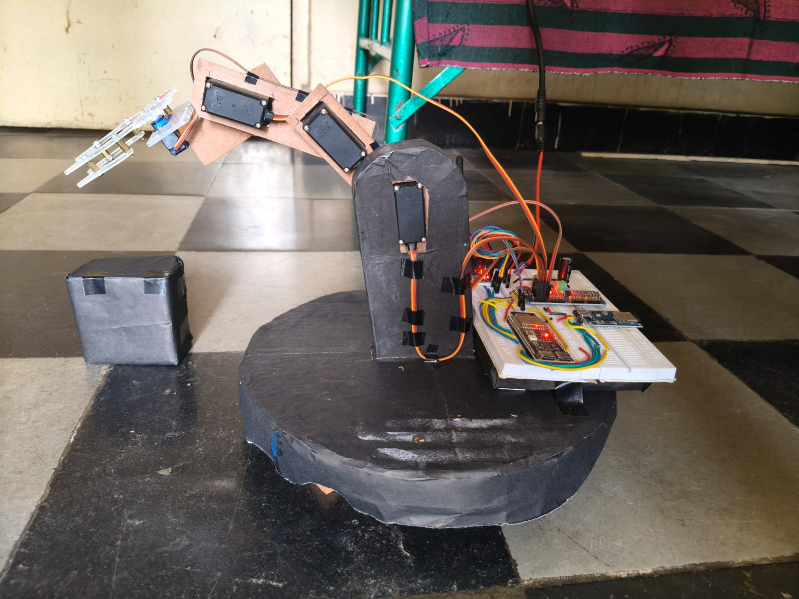
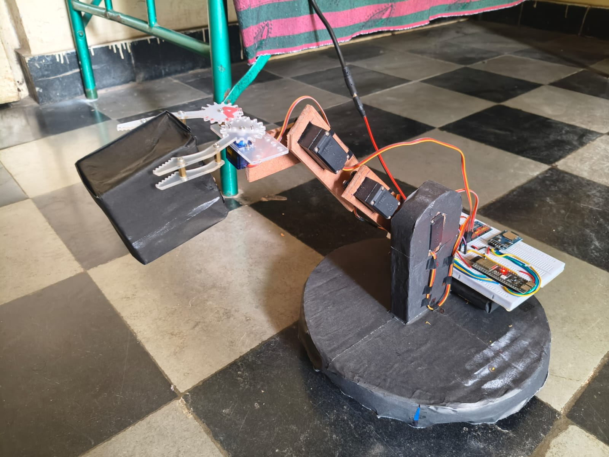
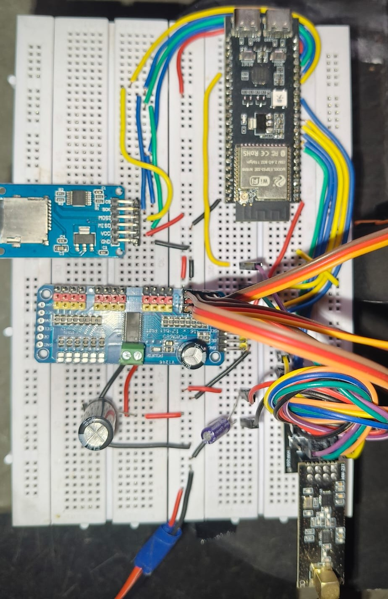
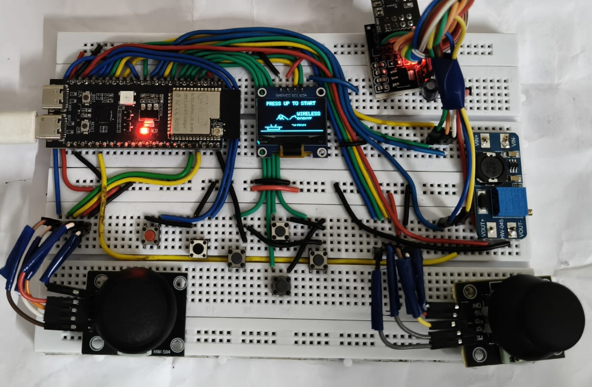

# Wireless Robotic Arm with Record and Playback Functionality

A wireless 4-DOF robotic arm developed using two ESP32-S3 microcontrollers, dual joystick control, nRF24L01+PA+LNA wireless communication, and SD-card-based motion recording and playback.

## Project Overview

The Wireless Robotic Arm is an embedded systems and robotics project designed to perform object handling through wireless joystick control.

The system uses two ESP32-S3 microcontrollers for wireless communication between the transmitter and receiver. The operator controls the robotic arm using dual joysticks, while an OLED display provides a user interface for system operation.

The robotic arm consists of four independently controlled axes: Base, Shoulder, Elbow, and Gripper.

The system also supports motion recording and playback. Joint movement data is stored in CSV format on a MicroSD card and can be replayed whenever required.

## 🎥 Project Demonstration

Watch the complete working demonstration of the ESP32-S3 Wireless 4-DOF Robotic Arm, including live joystick control, object handling, motion recording, and playback.

[](https://youtu.be/9cIs8g7y4Og)

**[▶ CLICK HERE TO WATCH THE COMPLETE PROJECT VIDEO](https://youtu.be/9cIs8g7y4Og)**

## Project Objectives

- Develop a wireless robotic arm using ESP32-S3 microcontrollers.
- Implement real-time control using dual joystick modules.
- Establish wireless communication using nRF24L01+PA+LNA modules.
- Control four servo motors using a PCA9685 PWM driver.
- Implement motion recording and playback using a MicroSD card.
- Develop an OLED-based user interface.
- Achieve smooth and reliable robotic arm movement.

## Key Features

- Wireless robotic arm control.
- Dual joystick operation.
- Four servo-controlled axes (4-DOF).
- Live joystick control mode.
- Smooth servo movement.
- OLED-based user interface.
- Wireless communication using nRF24L01+PA+LNA.
- Motion recording and storage in CSV format.
- Recorded motion playback.
- SD-card-based motion file management.
- Home position and stop commands.

## System Architecture

The project is divided into two main units.

### 1. Transmitter Unit

The transmitter collects joystick inputs and button commands and sends them wirelessly to the receiver.

**Main components:**

- ESP32-S3 microcontroller
- Two joystick modules
- SSD1306 OLED display (128 × 64)
- Push buttons
- nRF24L01+PA+LNA wireless module
- Rechargeable battery power supply

**Main functions:**

- Read joystick inputs.
- Send real-time movement commands.
- Display system information on the OLED.
- Control recording and playback commands.
- Send home and stop commands.

### 2. Receiver Unit

The receiver processes wireless commands and controls the robotic arm. It also manages motion recording and playback.

**Main components:**

- ESP32-S3 microcontroller
- PCA9685 16-channel PWM servo driver
- nRF24L01+PA+LNA wireless module
- MicroSD card module
- Four MG996R 180° servo motors
- External servo power supply

**Main functions:**

- Receive wireless control commands.
- Control four servo motors through PCA9685.
- Record joint movement data.
- Store motion data in CSV files.
- Read and replay previously recorded movements.
- Execute home and stop commands.

## Project Images

### 1. Complete Robotic Arm


### 2. Servo Motor Joints



### 3. Receiver Side Circuit



### 4. Transmitter Side Circuit



### 5. System Flow Diagram


## Hardware Components

| Component | Quantity | Function |
|---|---:|---|
| ESP32-S3 | 2 | Transmitter and receiver control |
| nRF24L01+PA+LNA | 2 | Wireless communication |
| PCA9685 | 1 | PWM servo control |
| MG996R 180° servos | 4 | Base, shoulder, elbow and gripper movement |
| Joystick modules | 2 | Manual control |
| SSD1306 OLED | 1 | User interface |
| MicroSD card module | 1 | Motion data storage |
| Push buttons | Multiple | User commands |
| External power supply | 1 | Servo power |

## Working Principle

The transmitter reads analog values from the two joystick modules and converts them into movement commands.

These commands are transmitted wirelessly using the nRF24L01+PA+LNA modules.

The receiver ESP32-S3 receives the commands and communicates with the PCA9685 servo driver to control the robotic arm.

During recording, the current joint positions are stored in CSV files on the MicroSD card. During playback, the receiver reads the stored positions and reproduces the recorded movements.

The OLED interface provides system information and user interaction.

## Motion Recording and Playback

The system supports recording and replaying robotic arm movements.

- **Live Control:** Joysticks directly control the robotic arm.
- **Record:** Stores the current joint movements on the MicroSD card.
- **Play:** Selects and replays a previously recorded motion file.
- **Stop:** Stops the current operation.
- **Home:** Returns the robotic arm to its predefined home position.

Recorded motion files are stored in CSV format using the following naming convention:

```text
/REC_01.csv
/REC_02.csv
/REC_03.csv
...
/REC_99.csv
```

This allows multiple motion sequences to be stored and selected for playback.

## Hardware Connections and Pin Configurations

Detailed transmitter and receiver circuit diagrams, GPIO pin configurations, and hardware connection details are available in the `Hardware/` folder.

The folder contains both editable draw.io source files and PDF versions of the circuit diagrams.

- Transmitter circuit: `Transmitter_Circuit.drawio` and `Transmitter_Circuit.pdf`
- Receiver circuit: `Receiver_Circuit.drawio` and `Receiver_Circuit.pdf`

Refer to these diagrams before connecting or powering the hardware.

## Software and Development Tools

- Arduino IDE
- Embedded C/C++
- ESP32 board package
- RF24 library
- Adafruit PWM Servo Driver library
- Adafruit SSD1306 library
- Adafruit GFX library
- SPI library
- SD library
- Wire library

## Repository Structure

```text
wireless-robotic-arm/
│
├── README.md
│
├── Documentation/
│   ├── Project_configuration.pdf
│   └── Project_report.pdf
│
├── Hardware/
│   ├── Transmitter_Circuit.drawio
│   ├── Transmitter_Circuit.pdf
│   ├── Receiver_Circuit.drawio
│   └── Receiver_Circuit.pdf
│
├── Images/
│   ├── Robotic_ARM.jpeg
│   ├── Sevomotor_joints.jpeg
│   ├── Receiver_side_circuit.jpeg
│   ├── Tranmitter_side_circuit.jpeg
│   └── Flow Diagram.png
│
└── code/
    ├── Transmitter/
    │   └── Transmitter.ino
    │
    └── Receiver/
        └── Receiver.ino
```

## How to Run the Project

1. Install Arduino IDE.
2. Install the ESP32 board package.
3. Install the required Arduino libraries.
4. Open the transmitter Arduino sketch.
5. Select the appropriate ESP32-S3 board and COM port.
6. Upload the transmitter code to the transmitter ESP32-S3.
7. Open the receiver Arduino sketch.
8. Select the appropriate ESP32-S3 board and COM port.
9. Upload the receiver code to the receiver ESP32-S3.
10. Connect all hardware according to the circuit diagrams.
11. Power on both units.
12. Use the joysticks to control the robotic arm.
13. Use the recording and playback controls to store and replay movements.

**Important:** Use a suitable external power supply for the servo motors. Do not power the MG996R servos directly from the ESP32-S3.

## Applications

- Educational robotics
- Embedded systems development
- Wireless robotic manipulation
- Motion recording and playback
- Automation and control systems
- Robotics prototyping

## Future Scope

- Additional robotic joints.
- Improved motion accuracy.
- Position feedback and closed-loop control.
- Computer vision integration.
- Advanced motion planning.
- Object detection and automatic pick-and-place operations.

## Project Information

**Project Title:** Wireless Robotic Arm with Record and Playback Functionality

**Institution:** Kalpatharu Institute of Technology, Tiptur

**Department:** Electronics and Communication Engineering

**Academic Year:** 2026

## Acknowledgement

We sincerely thank our project guide, faculty members, and Kalpatharu Institute of Technology for their valuable guidance, support, and encouragement throughout the development of this project.

---

**Developed as an academic embedded systems and robotics project.**# Wireless Robotic Arm with Record and Playback Functionality

A wireless 4-DOF robotic arm developed using two ESP32-S3 microcontrollers, dual joystick control, nRF24L01+PA+LNA wireless communication, and SD-card-based motion recording and playback.

## Project Overview

The Wireless Robotic Arm is an embedded systems and robotics project designed to perform object handling through wireless joystick control.

The system uses two ESP32-S3 microcontrollers for wireless communication between the transmitter and receiver. The operator controls the robotic arm using dual joysticks, while an OLED display provides a user interface for system operation.

The robotic arm consists of four independently controlled axes: Base, Shoulder, Elbow, and Gripper.

The system also supports motion recording and playback. Joint movement data is stored in CSV format on a MicroSD card and can be replayed whenever required.

## Project Objectives

- Develop a wireless robotic arm using ESP32-S3 microcontrollers.
- Implement real-time control using dual joystick modules.
- Establish wireless communication using nRF24L01+PA+LNA modules.
- Control four servo motors using a PCA9685 PWM driver.
- Implement motion recording and playback using a MicroSD card.
- Develop an OLED-based user interface.
- Achieve smooth and reliable robotic arm movement.

## Key Features

- Wireless robotic arm control.
- Dual joystick operation.
- Four servo-controlled axes (4-DOF).
- Live joystick control mode.
- Smooth servo movement.
- OLED-based user interface.
- Wireless communication using nRF24L01+PA+LNA.
- Motion recording and storage in CSV format.
- Recorded motion playback.
- SD-card-based motion file management.
- Home position and stop commands.

## System Architecture

The project is divided into two main units.

### 1. Transmitter Unit

The transmitter collects joystick inputs and button commands and sends them wirelessly to the receiver.

**Main components:**

- ESP32-S3 microcontroller
- Two joystick modules
- SSD1306 OLED display (128 × 64)
- Push buttons
- nRF24L01+PA+LNA wireless module
- Rechargeable battery power supply

**Main functions:**

- Read joystick inputs.
- Send real-time movement commands.
- Display system information on the OLED.
- Control recording and playback commands.
- Send home and stop commands.

### 2. Receiver Unit

The receiver processes wireless commands and controls the robotic arm. It also manages motion recording and playback.

**Main components:**

- ESP32-S3 microcontroller
- PCA9685 16-channel PWM servo driver
- nRF24L01+PA+LNA wireless module
- MicroSD card module
- Four MG996R 180° servo motors
- External servo power supply

**Main functions:**

- Receive wireless control commands.
- Control four servo motors through PCA9685.
- Record joint movement data.
- Store motion data in CSV files.
- Read and replay previously recorded movements.
- Execute home and stop commands.

## Project Images

### 1. Complete Robotic Arm


### 2. Servo Motor Joints


### 3. Receiver Side Circuit


### 4. Transmitter Side Circuit


### 5. System Flow Diagram


## Hardware Components

| Component | Quantity | Function |
|---|---:|---|
| ESP32-S3 | 2 | Transmitter and receiver control |
| nRF24L01+PA+LNA | 2 | Wireless communication |
| PCA9685 | 1 | PWM servo control |
| MG996R 180° servos | 4 | Base, shoulder, elbow and gripper movement |
| Joystick modules | 2 | Manual control |
| SSD1306 OLED | 1 | User interface |
| MicroSD card module | 1 | Motion data storage |
| Push buttons | Multiple | User commands |
| External power supply | 1 | Servo power |

## Working Principle

The transmitter reads analog values from the two joystick modules and converts them into movement commands.

These commands are transmitted wirelessly using the nRF24L01+PA+LNA modules.

The receiver ESP32-S3 receives the commands and communicates with the PCA9685 servo driver to control the robotic arm.

During recording, the current joint positions are stored in CSV files on the MicroSD card. During playback, the receiver reads the stored positions and reproduces the recorded movements.

The OLED interface provides system information and user interaction.

## Motion Recording and Playback

The system supports recording and replaying robotic arm movements.

- **Live Control:** Joysticks directly control the robotic arm.
- **Record:** Stores the current joint movements on the MicroSD card.
- **Play:** Selects and replays a previously recorded motion file.
- **Stop:** Stops the current operation.
- **Home:** Returns the robotic arm to its predefined home position.

Recorded motion files are stored in CSV format using the following naming convention:

```text
/REC_01.csv
/REC_02.csv
/REC_03.csv
...
/REC_99.csv
```

This allows multiple motion sequences to be stored and selected for playback.

## Hardware Connections and Pin Configurations

Detailed transmitter and receiver circuit diagrams, GPIO pin configurations, and hardware connection details are available in the `Hardware/` folder.

The folder contains both editable draw.io source files and PDF versions of the circuit diagrams.

- Transmitter circuit: `Transmitter_Circuit.drawio` and `Transmitter_Circuit.pdf`
- Receiver circuit: `Receiver_Circuit.drawio` and `Receiver_Circuit.pdf`

Refer to these diagrams before connecting or powering the hardware.

## Software and Development Tools

- Arduino IDE
- Embedded C/C++
- ESP32 board package
- RF24 library
- Adafruit PWM Servo Driver library
- Adafruit SSD1306 library
- Adafruit GFX library
- SPI library
- SD library
- Wire library

## Repository Structure

```text
wireless-robotic-arm/
│
├── README.md
│
├── Documentation/
│   ├── Project_configuration.pdf
│   └── Project_report.pdf
│
├── Hardware/
│   ├── Transmitter_Circuit.drawio
│   ├── Transmitter_Circuit.pdf
│   ├── Receiver_Circuit.drawio
│   └── Receiver_Circuit.pdf
│
├── Images/
│   ├── Robotic_ARM.jpeg
│   ├── Sevomotor_joints.jpeg
│   ├── Receiver_side_circuit.jpeg
│   ├── Tranmitter_side_circuit.jpeg
│   └── Flow Diagram.png
│
└── code/
    ├── Transmitter/
    │   └── Transmitter.ino
    │
    └── Receiver/
        └── Receiver.ino
```

## How to Run the Project

1. Install Arduino IDE.
2. Install the ESP32 board package.
3. Install the required Arduino libraries.
4. Open the transmitter Arduino sketch.
5. Select the appropriate ESP32-S3 board and COM port.
6. Upload the transmitter code to the transmitter ESP32-S3.
7. Open the receiver Arduino sketch.
8. Select the appropriate ESP32-S3 board and COM port.
9. Upload the receiver code to the receiver ESP32-S3.
10. Connect all hardware according to the circuit diagrams.
11. Power on both units.
12. Use the joysticks to control the robotic arm.
13. Use the recording and playback controls to store and replay movements.

**Important:** Use a suitable external power supply for the servo motors. Do not power the MG996R servos directly from the ESP32-S3.

## Applications

- Educational robotics
- Embedded systems development
- Wireless robotic manipulation
- Motion recording and playback
- Automation and control systems
- Robotics prototyping

## Future Scope

- Additional robotic joints.
- Improved motion accuracy.
- Position feedback and closed-loop control.
- Computer vision integration.
- Advanced motion planning.
- Object detection and automatic pick-and-place operations.

## Project Information

**Project Title:** Wireless Robotic Arm with Record and Playback Functionality

**Institution:** Kalpatharu Institute of Technology, Tiptur

**Department:** Electronics and Communication Engineering

**Academic Year:** 2026

## Acknowledgement

We sincerely thank our project guide, faculty members, and Kalpatharu Institute of Technology for their valuable guidance, support, and encouragement throughout the development of this project.

---

**Developed as an academic embedded systems and robotics project.**